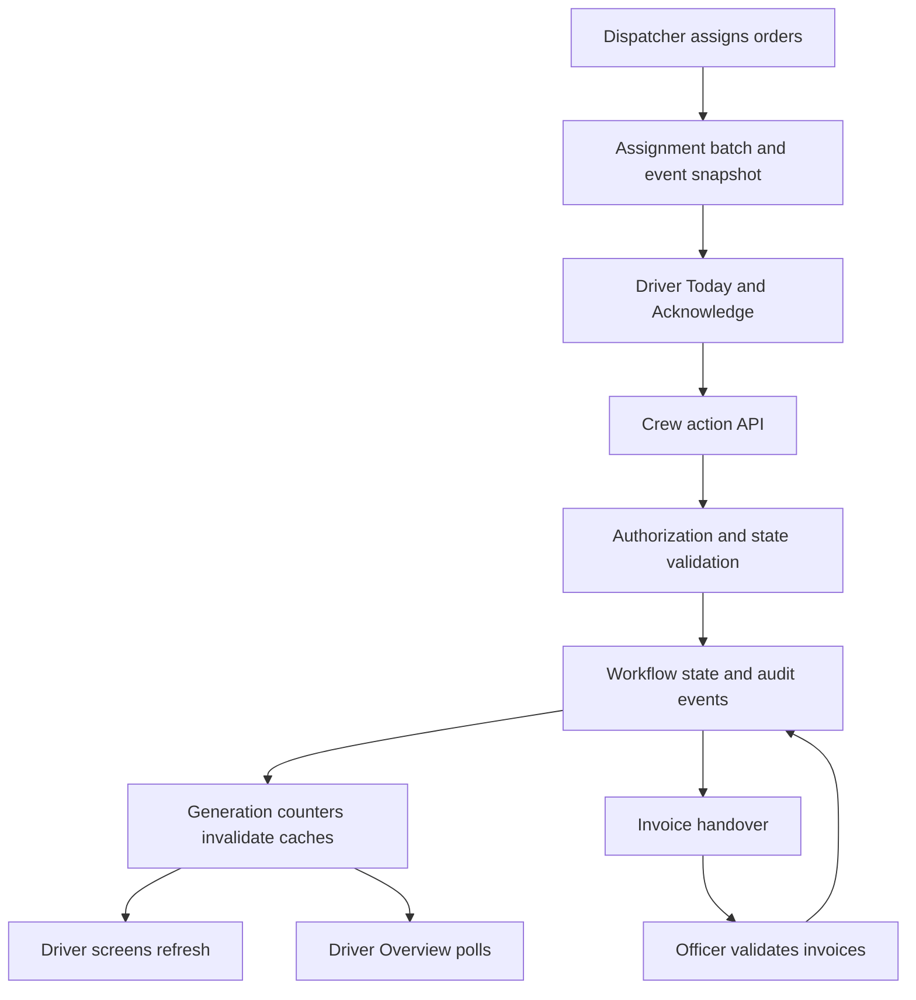
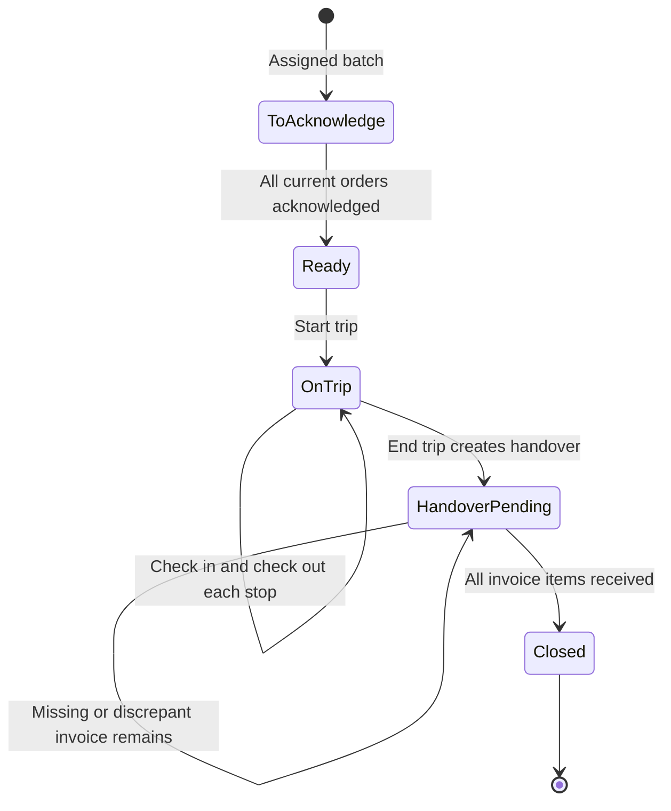

# Driver Overview and Driver Application: Detailed Functional and Technical Guide

Reviewed against repository source on **15 October 2026 (Asia/Manila)**.

This document explains the implemented Driver Overview dashboard and mobile driver/helper application, point by point: what each screen shows, what each action means, how the frontend decides what to display, which backend operations run, where data comes from, and how errors and offline work behave.

This is a source-code walkthrough, not a claim that the deployed application, live database, or external integrations were tested. Older specifications contain proposed features and earlier navigation structures. Where those differ, this guide follows the current source and calls out material limitations.

## Contents

1. [Purpose and relationship between the two interfaces](#1-purpose-and-relationship-between-the-two-interfaces)
2. [Architecture and data ownership](#2-architecture-and-data-ownership)
3. [Users, access, and authentication](#3-users-access-and-authentication)
4. [Shared business objects and calculations](#4-shared-business-objects-and-calculations)
5. [Driver Overview: complete screen walkthrough](#5-driver-overview-complete-screen-walkthrough)
6. [Driver application: complete screen walkthrough](#6-driver-application-complete-screen-walkthrough)
7. [Trip workflow: frontend and backend logic for every action](#7-trip-workflow-frontend-and-backend-logic-for-every-action)
8. [Forms, delivery evidence, and media](#8-forms-delivery-evidence-and-media)
9. [Offline behavior, retries, and synchronization](#9-offline-behavior-retries-and-synchronization)
10. [Dispatch changes and removed assignments](#10-dispatch-changes-and-removed-assignments)
11. [Invoice handover and officer validation](#11-invoice-handover-and-officer-validation)
12. [API reference](#12-api-reference)
13. [Persistence and cache reference](#13-persistence-and-cache-reference)
14. [UI/UX design and interaction rules](#14-uiux-design-and-interaction-rules)
15. [Examples from assignment to closure](#15-examples-from-assignment-to-closure)
16. [Current limitations and implementation discrepancies](#16-current-limitations-and-implementation-discrepancies)
17. [Source map and verification checklist](#17-source-map-and-verification-checklist)

## 1. Purpose and relationship between the two interfaces

### 1.1 Driver Overview

1. Driver Overview is the operations team's monitoring interface at `/app/driver-overview`.
2. Its backend permits administrators and dispatchers.
3. It answers operational questions:
   - Who has assignments today?
   - Who has acknowledged their work?
   - Who has started a trip?
   - Which stops have been visited and checked out?
   - Which deliveries were delivered, partial, or failed?
   - Which signed invoice copies still need officer validation?
   - Which driver concerns require a response?
4. Most of the dashboard is read-only monitoring. Issue responses are an explicit write action. Form editing is available elsewhere in Admin settings.
5. The dashboard does not perform crew actions on behalf of a driver.

### 1.2 Driver application

1. The driver application is a mobile-oriented React web interface under `/driver/*`.
2. Drivers and helpers use the same trip workflow.
3. The application guides the crew through acknowledgement, trip start, arrival, departure/delivery logging, trip end, and invoice handover instructions.
4. The four current primary navigation destinations are **Today, Acknowledge, History, and Profile**.
5. Alerts are opened from the bell. An individual trip has one dedicated screen with a changing primary action.
6. The application also provides customer/crew/dispatch calling, external navigation, problem reporting, language selection, and offline trip-action synchronization.

### 1.3 How the interfaces stay connected

1. Dispatch assigns orders into a batch.
2. The driver or helper performs an action against that batch.
3. The backend validates the caller and the workflow state.
4. An accepted action changes durable workflow state and records audit events.
5. The backend increments a process-memory generation counter after a committed trip action.
6. Driver queries are invalidated locally after actions; Overview retrieves refreshed data through polling and cache invalidation.
7. The two interfaces share counting logic through `backend/services/day_model.py`.
8. There is no business-event WebSocket connection in these screens. The dashboard is near-real-time through polling.

## 2. Architecture and data ownership

### 2.1 Frontend responsibilities

1. React renders the dashboard and driver screens.
2. Wouter resolves page routes, URL parameters, and legacy redirects.
3. TanStack React Query manages requests, query keys, loading/error states, refetching, and invalidation.
4. API service modules build authenticated requests.
5. Pure helper modules calculate display labels, effective offline state, navigation targets, form visibility, validation, and progress.
6. Browser storage supports saved responses and pending trip actions.
7. Browser geolocation captures a position when a crew action is submitted.
8. Browser links hand calls to the phone dialer and directions to Google Maps.
9. The frontend's disabled buttons and hidden controls help users follow the workflow; backend validation remains authoritative.

### 2.2 Backend responsibilities

1. FastAPI routers expose driver, trip, Overview, issue, alert, and media endpoints.
2. Authentication dependencies resolve the current user and enforce roles.
3. Driver routers resolve the permitted staff ID before requesting assignment data.
4. Services load assignment facts, derive trip state, validate forms, execute transactions, and produce response payloads.
5. SQLAlchemy accesses approved Neon tables.
6. Memory caches reduce repeated reads and supply staff and live-order fallback details.
7. The selected Google Drive or Cloudflare R2 provider holds image bytes.
8. The Python `backend/routers` and `backend/services` files implement these workflows; the separate `artifacts/api-server` directory is not their implementation.

### 2.3 Source ownership

| Data | Owner/source | How these features use it |
|---|---|---|
| Live Sales Orders and transfer-order content | Zoho and live process-memory caches | Upstream dispatch source; driver/Overview services do not call Zoho directly |
| Live fleet telemetry/GPS | Cartrack and live memory stores | Separate from the phone's action GPS; no map is mounted in the current Overview UI |
| Staff names, phones, roles, warehouses | n8n staff directory through memory cache | Crew identities, contact actions, warehouse filtering |
| Login account, linked staff ID, enabled status | `users` and authentication services | Login and permissions |
| Assigned-order historical snapshot | `sales_orders`, `sales_order_lines` | Current driver/Overview code also reads these snapshots for today's assignments |
| Trip state and action history | Approved trip workflow tables | Acknowledgement, stop activity, handover, audit timeline |
| Delivery images/signatures | Google Drive / R2 compatibility | Selected provider holds bytes; Neon keeps metadata and references |
| Driver issues | `driver_issues` | Reports, priorities, statuses, dispatch replies |
| Driver alert content | Computed from existing records | No separate durable alert-content table |
| Alert read state | `driver_alert_reads` | Per-user read/unread markers |
| Pending offline actions and saved screens | Browser storage | Phone-side recovery and retries |

### 2.4 Database policy discrepancy that must remain visible

The repository's `AGENTS.md` says today's Sales Orders, fleet status, and GPS must use live APIs/memory, with no DB reads for today. However, the existing driver implementation explicitly reads today's assignment snapshots from Neon:

1. `driver_assignments.today_view()` rebuilds its cache through `rows_for_driver(db, driver_id, today, today)`.
2. `rows_for_driver()` selects `SalesOrderHistory` rows.
3. Overview's `Data` calls `day_model.load()` for the selected date range, including today.
4. `docs/DATABASE.md` documents these existing driver-specific read paths, alongside its broader live-data rule.
5. A cache hit avoids some repeat reads; caching does not make the underlying read path memory-only.
6. This guide reports the implementation and the inconsistency. It does not approve a new read/write path, change a schema, or resolve that policy decision.
7. Today's open-issue counts, alerts, and other workflow/configuration reads also mean an entire driver request should not be described as having zero database activity.

## 3. Users, access, and authentication

### 3.1 Role matrix

| Capability | Driver/helper | Administrator | Dispatcher | Logistics officer |
|---|---|---|---|---|
| Read permitted driver assignment payloads | Own linked staff record | Explicit `driver_id` required | Not through the ordinary driver assignment routes | Not through the ordinary driver assignment routes |
| Perform crew trip actions | Yes, for own crew assignments | Read-only; service rejects acting | No | No |
| Read Driver Overview | No | Yes | Yes | No through Overview routes |
| Respond to driver issues | No | Yes | Yes | No through issue-response route |
| Edit form templates | No | Yes | Read only | No through Overview routes |
| Read own alerts/issues | Yes | Crew-only endpoints reject admin | No | No |
| Validate invoice handovers | No | Subject to officer endpoint rules | Subject to officer endpoint rules | Dedicated officer workflow |

The officer workflow has its own router and checks. Overview visibility does not grant invoice-validation permission.

### 3.2 Staff identity versus login identity

1. `user.id` identifies the login account and actor in audit records.
2. `user.staff_id` links that account to an n8n staff-directory record.
3. A batch has one primary `driver_id` and a collection of helper IDs.
4. A logged-in helper can see work where their staff ID appears in the crew.
5. A crew user cannot inspect a different person's data by changing `?driver_id=`.
6. A missing staff link produces a forbidden response and a contact-dispatch message.
7. An admin must supply the staff ID to inspect the driver application in read-only mode.
8. The SQL crew prefilter is followed by an exact membership check, preventing staff ID `1` from matching staff ID `17` merely because of text similarity.

### 3.3 Login and session handling

1. The public driver sign-in page is `/driver/login`.
2. The login supports the existing phone/email identifier flow and password authentication.
3. Incorrect credentials receive a generic message rather than revealing whether an account exists.
4. Too many failed attempts produce HTTP 429.
5. The in-memory login limiter uses identifier/account/IP checks; documented behavior is five failures within 15 minutes.
6. Driver/helper JWTs default to a longer lifetime of 30 days, subject to configuration.
7. The driver layout deliberately avoids the desktop AppShell's idle-logout behavior.
8. Backend account-status checks still apply. A disabled account is not authorized simply because its JWT has not expired.
9. User data is cached for ten minutes; explicit admin status changes invalidate that cache, while direct database changes may wait for cache expiry.

### 3.4 Forgot password, password change, and logout

1. `/driver/forgot-password` explains how to contact dispatch for a reset link.
2. It obtains the real dispatch phone from the public support endpoint.
3. It does not trigger a self-service reset email.
4. Admin-issued invite/reset links are single-use; the database stores a token hash and expiry rather than the plaintext link token.
5. The Profile password sheet requests current password, new password, and confirmation.
6. The frontend checks a minimum of eight characters and matching confirmation; the backend checks the current password and its password policy.
7. Password-change success appears only after the backend accepts the request.
8. Logout warns when the phone has actions that are not done.
9. It calls the existing logout endpoint, then clears the local session and React Query cache even if that request fails offline.
10. The backend logout endpoint acknowledges the request but does not revoke a stateless JWT through a token blacklist. Do not describe logout as server-side JWT revocation.

## 4. Shared business objects and calculations

### 4.1 Assignment batch

1. One assignment action creates an `assignment_batch_id` for that group of orders.
2. A batch is the identity of a trip assignment; a vehicle plate is not a unique trip identity.
3. Two assignment batches using the same truck remain separate trips.
4. Old rows without a batch ID receive a stable legacy key based on assignment time and vehicle.
5. Trip numbering distinguishes Trip 1, Trip 2, and so on for the relevant day's assignments.
6. Crew is the primary driver plus helpers. Helper calculation removes the primary driver's ID by value instead of assuming an array position.

### 4.2 Assignment state, trip state, and outcome are different

| Layer | Examples | Meaning |
|---|---|---|
| Assignment snapshot status | `assigned`, `manifested`, `completed`, `delivered` | Whether the order belongs to the visible dispatch/history set |
| Stored trip status | `pending`, `on_trip`, `returned`, `handover_submitted`, `closed` | Lifecycle of the batch execution and invoice handover |
| Derived display state | `to_acknowledge`, `ready`, `on_trip`, `returned`, `handover_pending`, `closed`, `idle` | What cards and filters show |
| Stop status | `pending`, `checked_in`, `checked_out` | Visit progress for an order |
| Stop outcome | Delivered, Partially delivered, Failed | Result recorded at check-out |
| Invoice officer status | `pending`, `received`, `missing`, `discrepancy` | Whether the physical invoice copy passed officer validation |

1. A trip can have every stop checked out while some deliveries failed.
2. A trip can have finished its deliveries while invoice validation remains pending.
3. A crew delivery outcome is not automatically a Zoho order update.
4. Transfer-order checkout has a specific local completion rule described below.

### 4.3 Display-state derivation

| Condition | Display state | Next crew step |
|---|---|---|
| No assignments for a listed active driver | `idle` | Wait for dispatch |
| Pending trip with unacknowledged orders | `to_acknowledge` | Open Acknowledge |
| Pending trip with every current order acknowledged | `ready` | Start trip |
| Started trip | `on_trip` | Arrive, check out, or end depending on stops |
| Older ended trip without automatic handover | `returned` | Submit legacy/compatibility handover |
| Trip has submitted invoice handover | `handover_pending` | Give physical copies to officer; wait for validation |
| Officer workflow closes trip | `closed` | Review only |

### 4.4 Counts and progress

1. `acknowledged` counts orders with an acknowledgement in that batch.
2. `stops_done` counts current batch orders whose stop status is `checked_out`.
3. `delivered`, `partial`, and `failed` are outcome buckets among checked-out stops.
4. Removed orders' historical acknowledgements/stops remain stored but do not count toward the current batch or block its completion.
5. Progress percentage is rounded from `done / total * 100`, bounded to a valid display range where the helper is used.
6. Progress completion does not mean delivery success: 3 checked-out stops may be 2 delivered and 1 failed.
7. The driver Today screen's **Done** value now uses checked-out visits; failed/partial outcomes remain distinct from successful deliveries.

### 4.5 Weight and packs

1. Known line weights are summed into kilograms.
2. Missing line weights are tracked in `kg_unknown_lines`.
3. `kg_complete` identifies whether the weight is complete.
4. Overview uses `formatKgPartial()` to show partial-weight context instead of treating missing weights as confirmed zero.
5. The simplified driver cards display positive kilogram totals and do not expose all of Overview's incomplete-weight messaging.
6. Pack totals count supported pack units; they are not simply every item's quantity added together.
7. A null pack total means no usable pack count is known, which differs from a known zero.

## 5. Driver Overview: complete screen walkthrough

### 5.1 Trip-based page structure

1. Overview opens at `/app/driver-overview` for administrators and dispatchers.
2. The primary object is an assignment **batch/trip**, not a person. A driver and helper share one trip row; two batches on the same truck remain two rows.
3. The page has one filter bar, five selectable status tiles, and three tabs: Trips, Invoices to collect, and Issues.
4. Export CSV is a filter-bar action. The former Live tab, separate Export tab, person panel, and its sub-tabs are removed.
5. An individual trip opens in a right-side drawer on desktop and a full-screen sheet on mobile. Everything is on one scroll; there are no nested sub-tabs.
6. No map or template editor is mounted in Overview. Templates remain in Admin settings.

### 5.2 Unified URL filters

| Control | Logic |
|---|---|
| Date / previous / next / Today | Manila calendar day; default today |
| Range | Replaces the single day with From/To, maximum 366 inclusive days |
| Warehouse | All / METS / GLACIER |
| Search | Driver, helper, truck, order reference, Invoice/DR, customer |
| Status tile | Click a tile to filter; click again to clear |
| List / Table | Same trip data in operational rows or familiar historical columns |

1. Date/range, warehouse, search, tile, active tab, view, open trip, and focused stop are represented in the URL.
2. Refresh/deep links restore the view; browser Back can restore an earlier filter/drawer state.
3. Trips, tiles, the order summary line, and CSV share the server's filter implementation.
4. Invoices and Issues default to outstanding work across all dates and label this explicitly. Their Only this date option restricts to the chosen single day; range mode does not silently pretend this is a range filter.
5. Search and warehouse still apply to those outstanding worklists. There is no second driver search or separate status dropdown.
6. Legacy Overview query parameters are translated by the URL model.

### 5.3 Five trip-count tiles

| Tile | Included trips |
|---|---|
| Loading | Pending, still acknowledging or ready to start |
| On the road | Stored on_trip |
| Back, invoices due | Returned or handover_submitted, not closed |
| Closed | Stored closed |
| Needs attention | Any trip with computed attention flags, including trips also counted in a lifecycle tile |

1. All tile counts describe batches, not distinct people.
2. The backend returns tile_counts before applying the selected tile, so selecting one does not collapse the other tiles' counts.
3. The list for a selected tile must have exactly the tile's count for the same date, warehouse, and search.
4. A quiet orders line separates delivered, partial, not delivered, and to-go totals. Checked-out visits and successful delivery outcomes remain different measurements.
5. Missing-weight information stays visible with kilogram totals.
6. Active drivers with no assignments move to a collapsed Not assigned today list rather than becoming trip rows.

### 5.4 Trip list and table

1. Each row shows plate, Trip N of M, warehouse, primary driver and helpers, available call links, the Load / Deliver / Return rail, delivery outcomes, invoice receipt counts, last crew activity, and attention chips.
2. Load describes acknowledged orders; Deliver describes checked-out stops; Return describes received invoice copies.
3. Attention trips sort first, followed by on-road, loading, back, and closed, then truck identity.
4. Last activity excludes dispatcher unassignment so removing an order does not falsely refresh crew activity.
5. On-road activity older than DRIVER_STALE_MINUTES produces No activity attention.
6. A row supports clicking, Enter, and Space. It opens the drawer and writes the trip ID to the URL.
7. Range mode groups trip rows by day.
8. Table view retains Date, Driver/helpers, Vehicle/trip number, Status, SOs, Done, Weight, Packs, Outcomes, Trip length, and Started.
9. Tables scroll within their container rather than widening the page.

### 5.5 Attention computation

Flags are calculated on the server over the existing assignment/trip facts, events, issues, invoice items, and relevant form rules. No attention table or background persistence job is introduced.

| Flag | Meaning |
|---|---|
| no_activity | On-road crew activity older than the configured threshold |
| not_delivered | A failed/returned stop outcome |
| partial | A partially delivered stop |
| problem_open | An open issue linked to the trip |
| far_checkin | Arrival more than 500 metres from the destination |
| no_gps | Relevant crew action has no usable GPS |
| invoice_missing | Officer recorded a missing invoice |
| invoice_discrepancy | Officer recorded an incorrect/discrepant invoice |
| order_removed | Dispatch removed work with relevant acknowledgement/started context |
| photo_missing | A delivered/partial checkout lacks photo evidence required by its stored template rules |

Flags carry stop/event references when available. The drawer uses these to point at the underlying evidence, rather than treating a warning as proof of a new workflow state.

### 5.6 Trip drawer

Sections appear in this order:

1. Header: truck, trip number, crew/calls, step rail, times/actors/duration, weight and packs, warnings.
2. Stops in delivery order, or assignment order before start: order badge/reference/customer, outcome, arrival/departure, Invoice/DR, officer status, proof thumbnail.
3. Expanded stop evidence: acknowledgement actor/time/GPS/template answers, discrepancy notes, arrival client/receipt times/GPS/distance/far condition, departure actor/time/GPS/outcome/reason/template answers, photos and officer validation details.
4. Invoices for this trip: references, recorded responsibility, received/missing/wrong status, officer/check details.
5. Trip issues with their photos, status and reply controls.
6. Collapsed Activity log: all action events, including dispatcher removals and prior-state detail.
7. Collapsed Other days for this crew: recent trips that open the corresponding drawer.

The drawer supports Escape, focus trapping, previous/next trip, and direct stop links. Refreshing data must preserve the open drawer and manually expanded evidence. A photo opens an in-app viewer with a caption and previous/next navigation; no Google Drive UI is required.

### 5.7 Invoices to collect

1. The worklist uses the existing hardcopies endpoint and defaults to All dates ? anything not yet received.
2. Its local states are All, With driver, With officer, Not handed over, Missing, and Wrong (the plain label for discrepancy).
3. Columns retain order/reference, Invoice/DR, customer, truck/driver, status, since/date, and note.
4. Selecting a row opens that trip and focuses its stop.
5. The system's responsibility label is a workflow declaration, not a physical tracking signal. End trip submits handover automatically; an officer must still verify receipt.
6. Officer validation stays in the dedicated officer interface. Overview does not change those permissions.
7. Legacy returned trips with handover items must not also show a duplicate with-driver copy.

### 5.8 Issues and replies

1. Open / All / Resolved / Closed uses the existing issue statuses and response endpoint.
2. Cards retain reference, reporter/role, priority, category, context, description, status, last response, and timestamps.
3. Attached photos appear as thumbnails with order/date/time/result captions.
4. A trip reference opens its drawer. The same IssueCard supports responses from both the main tab and drawer.
5. Save is disabled when unchanged or saving. Replies are limited to 2,000 characters.
6. A repeated identical response writes nothing. Accepted edits invalidate affected overview queries so tab and drawer can converge.
7. The tab badge identifies open issues across dates; visible cards still obey their explicit status/search/warehouse/date scope.

### 5.9 Export and refresh

1. Export requests the current date/range, warehouse, search, and tile, using authenticated fetch.
2. Existing CSV columns, UTF-8 BOM, quoting, spreadsheet-formula protection, and Manila timestamps remain.
3. The UI shows Preparing and the returned filename or error.
4. List/tiles and an open drawer poll every 15 seconds while visible; hidden-tab background polling is disabled.
5. Updated is based on the most recent successful data fetch, rather than merely rendering the component.
6. Errors provide Retry, empty results show the active scope and Clear filters, and loading uses skeleton rows.

## 6. Driver application: complete screen walkthrough

### 6.1 Preserved routes and flow

The polish keeps Today, Acknowledge, History, and Profile as the four primary tabs, Alerts behind the bell, and `/driver/trip/:batch_id` as the execution screen. Login, forgot-password, legacy redirects, one-tap acknowledgement, start/check-in/check-out/end order, crew permissions, and template requirements remain.

| Route | Purpose |
|---|---|
| /driver/login | Sign in, including English/Tagalog selection |
| /driver/forgot-password | Dispatch-assisted reset instructions |
| /driver/today | Current trips, stops and checked-out progress |
| /driver/acknowledge | Acknowledge trip orders; historical date review is read-only |
| /driver/trip/:batch_id | Existing single-screen trip execution |
| /driver/history | Past trips and read-only trip entry |
| /driver/alerts | Computed events and read markers |
| /driver/profile | Identity, today's crew/vehicles, language, password and logout |

### 6.2 Today and trip wording

1. Today keeps its greeting, date, bell, dispatch call, trip cards, crew call controls, order/weight/pack details, and first unfinished trip emphasis.
2. Done now counts checked-out visits consistently with the trip screen. Not-delivered work is shown separately so completion does not imply success.
3. A trip waiting for invoice validation no longer claims Delivered as its overall state; wording identifies waiting/back-with-invoices-due.
4. The existing trip header gains a compact Load / Deliver / Return rail based on the shared backend step payload.
5. The current-stop card, item expansion, navigation handoff, arrival action, delivery sheet, issue sheet, and end confirmation retain their structure.
6. Customer/crew/dispatch calls use real available phone numbers. Navigation opens Google Maps without inventing a live ETA.
7. Actual driver/helper authorization is still enforced by the backend.

### 6.3 Acknowledge, history and account screens

1. Acknowledge stays one action per trip with an optional configured checklist first; already acknowledged orders are not duplicated.
2. Today/Yesterday/date selection retains historical read-only behavior.
3. History keeps rolling 7/30-day selection, date grouping, twenty-batch pages and Load more.
4. Past-trip links preserve from=history read-only entry.
5. Profile remains informational for dispatch-controlled staff, vehicle and crew fields.
6. Password change validates locally and through the backend; success requires an accepted response.
7. Logout still warns for unfinished queued actions and clears the local session/query state.
8. Forgot password still directs the user to dispatch; it does not pretend to send a reset email.
9. Full English/Tagalog dictionary coverage now includes operational errors, form labels, queue feedback, photo captions, login, and problem choices. Backend enum values remain stable for reporting.

### 6.4 Photo capture and early upload

1. A large Take photo control uses image input with capture=environment to request the rear camera.
2. After capture, the crew sees a thumbnail, caption, Retake and enlargement affordance.
3. Browser canvas compression targets JPEG around quality 0.7 and a longest side of 1600 pixels; a compression failure retains the original for backend checks.
4. Capture time and a stable upload key belong to the selected file value and travel through immediate upload or later queued replay.
5. Upload starts after capture where possible, allowing transfer to overlap the crew's remaining form entry.
6. Thumbnail feedback distinguishes Sending, Sent, and Saved, will send.
7. Checkout references an existing successful upload ID or queues the blob with its original key. It must not create a second upload because the user taps submit during an earlier upload.
8. Photo requirement/visibility stays controlled by active templates and storage availability.
9. With storage off, Photo not available is visible and impossible media requirements are skipped.
10. Captions use payload/local capture metadata: order, Manila date/time, result. Customer/crew naming is derived server-side for storage descriptions, not trusted from upload fields.

### 6.5 Offline problem reports

1. Problem? retains category tiles, optional whole-trip/order selection, note and optional image.
2. The action now uses queue kind issue and POST /api/driver/issues through the existing submitter.
3. Its existing phone-generated idempotency key is preserved across reconnects.
4. Attached photos use the same upload-key/blob pipeline as checkout.
5. Offline acceptance says Saved, will send; Sent is reserved for a successful server response.
6. Reporting an issue does not check out the stop or automatically change its delivery outcome.
7. Truck/cold-related categories retain high priority; enum/category mappings remain compatible with backend validation.

### 6.6 Live officer results and dispatch changes

1. Assignment payloads now include invoice_handover_items with order/reference, officer status and checked time.
2. The post-trip invoice list reads those durable payload values, not only the End trip response kept in a single frontend session.
3. Officer validation/resolution bumps trip-event generation; the next cache rebuild can expose Missing, Received or Wrong.
4. Today and live assignment reads poll every 25 seconds while visible and refresh on focus, visibility resume, online and action completion.
5. Polling pauses while hidden. This does not introduce a Zoho request on each phone poll.
6. Existing order/trip-removed banners and terminal queue-drop semantics remain.
7. The existing backend Today cache still rebuilds after its generation changes or its 300-second TTL. The cache was not redesigned to remove those existing reads.

### 6.7 Theme and bottom sheets

1. Colors and fonts resolve through shared dashboard CSS variables via themeTokens.ts; driver route/layout/size structure is preserved.
2. New status text/background pairs are checked for normal-text contrast of at least 4.5:1.
3. No page-local hexadecimal palette is retained in driver screen code.
4. The shared sheet backdrop uses the locally bundled Pexels #4246120 asset with token-based dark overlay; the sheet remains white.
5. The background asset is bundled into the frontend rather than requested from an external photo URL at runtime.
6. A bundled asset is available with the loaded app; this does not claim a new installable PWA/service-worker offline boot mechanism.
7. Tap-to-dismiss and existing sheet confirmation flow remain; the same before/after three-stop tap benchmark verifies no added interaction cost.

## 7. Trip workflow: frontend and backend logic for every action

### 7.1 State transition diagram

Ready and ToAcknowledge are derived states while stored trip status remains pending. The normal End trip transaction briefly sets returned and then sets handover_submitted when it creates the handover; callers observe the submitted state after commit.

### 7.2 Common crew-action pipeline

1. The frontend blocks duplicate in-flight taps with a busy state/ref.
2. It captures phone GPS with an eight-second timeout.
3. It creates an action body containing an idempotency key, client time, GPS or a denial/unavailability reason, and action-specific values.
4. The submitter attempts an online operation or stores it for queue processing when required.
5. The server first verifies that the caller is a driver/helper in the batch's current crew.
6. It checks whether the idempotency key already has a saved result for the batch.
7. It records server receipt time separately from accepted client time.
8. It loads current trip/acknowledgement/stop/handover facts.
9. The action handler validates the transition and form.
10. Successful state changes and their audit events are committed together.
11. The response includes refreshed batch state and duplicate/replay indicators where applicable.
12. After commit, the trip-event generation changes so dependent caches become invalid.
13. The frontend updates the assignment query from the response, saves the batch cache, and invalidates Today/assignment queries.
14. A queued action is shown as saved on this phone, with local effective-state overlays; only accepted server results become durable shared state.

### 7.3 Acknowledge all

1. Endpoint: `POST /api/driver/batches/{batch_id}/acknowledge-all`.
2. The backend identifies current orders that do not already have acknowledgements.
3. If none remain, it returns already done without another write.
4. Acknowledgement of new work is refused after the trip has started.
5. The checklist is enabled only when an active, non-draft acknowledgement template has items.
6. With the checklist off, no answers are required, but the configured template reference still accompanies acknowledgement records.
7. With the checklist on, answers are validated for every remaining order; errors reject the operation before partial acknowledgement writes.
8. A trip record is created lazily if it does not yet exist.
9. Each new order acknowledgement records template/version, actor identity/role/staff ID, action time, receipt time, and GPS.
10. Each newly acknowledged order receives an acknowledged event.
11. The first event owns the idempotency key and stored bulk response.
12. Everything commits in one transaction.
13. Either authorized crew member can acknowledge the shared orders; it is not a requirement for driver and helper to acknowledge separately.
14. The older per-order acknowledgement endpoint remains available, but the simplified screen uses bulk acknowledgement.

### 7.4 Start trip

1. Endpoint: `POST /api/driver/batches/{batch_id}/start`.
2. Every current order must be acknowledged.
3. Repeating a start on an already started/later-state trip returns already done rather than a second start.
4. The stop-order service chooses the available order/source.
5. One pending `trip_stops` row is created per current order, freezing sequence, reference, customer, address, and available coordinates.
6. The trip becomes on_trip and records start actor, times, and GPS.
7. A trip_started event records the sequence and source.
8. Starting does not mark orders delivered and does not start continuous phone GPS streaming.
9. The configurable acknowledgement checklist is the relevant readiness gate in this workflow; do not assume a separate Fleet Health pretrip-checklist row is required by this start handler.

### 7.5 Arrive / check in

1. Endpoint: `POST /api/driver/batches/{batch_id}/orders/{so_id}/check-in`.
2. The trip must be on trip and the order must be a current member with a frozen stop.
3. Only one stop may be checked in at a time.
4. If another stop is open, the server asks the crew to check out there first.
5. An already checked-in or checked-out stop returns an already-done result for check-in.
6. The backend records arrival actor, client/receipt timestamps, and GPS.
7. If phone and destination coordinates exist, it calculates distance in metres.
8. Distance over 500 metres sets a far flag and prompts a warning.
9. A far arrival is a warning, not a hard geofence rejection.
10. Missing/denied GPS does not invent a distance; workflow can proceed with the recorded location condition.
11. The frontend recommends the next pending stop in sequence. The backend check-in rule requires an eligible pending stop and no other open stop; it does not strictly enforce that every prior sequence number was completed.

### 7.6 Depart / check out

1. Endpoint: `POST /api/driver/batches/{batch_id}/orders/{so_id}/check-out`.
2. The order must belong to the current batch, the trip must be on trip, and the stop must be checked in.
3. An already checked-out stop returns already done.
4. The request names a checkout template and provides answers.
5. The backend loads that template version and validates visible/required fields and media references.
6. Validation failures return HTTP 422 with field-level errors; the frontend maps these back into the sheet.
7. Accepted checkout records actor, departure time, receipt time, GPS, outcome, reason, answers, and template/version.
8. The stop becomes checked_out.
9. A checked_out event records the action.
10. Delivered, partial, and failed all finish the visit, while remaining separate reporting outcomes.
11. The current SO sheet strips non-digits from the typed Invoice/DR field and requests a numeric keyboard. Template rules still govern backend validation.
12. For a transfer order, the reference is read-only; the backend ignores a submitted Invoice/DR value and stores the order's TO number itself.
13. A delivered/partial TO with local assignment status assigned is marked completed locally and updated in the live assignment cache during checkout handling.
14. This workflow does not write delivery forms or Sales Order outcomes back to Zoho.
15. If an admin template has no outcome field, the backend falls back to Delivered. Template edits therefore affect operational semantics and must be reviewed carefully.

### 7.7 End trip

1. Endpoint: `POST /api/driver/batches/{batch_id}/end`.
2. The trip must have started.
3. Every remaining current order must have a checked-out stop.
4. Pending/open stops block the action with an explicit count.
5. Partial/failed visits satisfy the visit-completion check because they are checked out; unresolved issues are not an additional blocker in this handler.
6. The backend records end actor, times, GPS, and distance to a recognized warehouse when calculable.
7. It does not enforce a hard return-to-warehouse radius.
8. In the same transaction it creates a pending invoice handover with no chosen officer.
9. It creates one handover item per current order and copies Invoice/DR or TO reference.
10. Automatic items are initially handed_over=true with officer_status=pending.
11. It records trip_ended and handover_submitted audit events, with one idempotency key on the primary action event.
12. The stored trip state becomes handover_submitted.
13. The UI still instructs the crew to physically give the copies to the officer. Automatic submission is not independent evidence of physical receipt.
14. Repeating End trip does not duplicate handovers or invoice items.

### 7.8 Compatibility handover

1. Endpoint: `POST /api/driver/batches/{batch_id}/handover`.
2. If End trip already created a handover, this returns the existing one.
3. An old returned trip without a handover can use this path.
4. The new compatibility request can create the automatic full-trip handover without choosing an officer.
5. The older form-based path validates an optional active officer, complete item coverage, and notes for copies not handed over.
6. The simplified current app no longer presents the former separate multi-step handover wizard as its normal end-of-trip flow.

### 7.9 Time and audit rules

1. Client action time and server receipt time are separate fields.
2. The backend accepts valid queued client times within its allowed skew window.
3. Client times more than three days old or more than ten minutes in the future are adjusted to server receipt time by the shared parser.
4. Audit records retain actor, role, batch/order association, GPS condition, payload, and idempotency result where relevant.
5. Display formatting uses Manila time for driver/operations dates and clocks.
6. A reported action timestamp is not necessarily the moment the server received an offline action.

## 8. Forms, delivery evidence, and media

Provider-specific upload, naming, OAuth and streaming behavior is documented in [GDRIVE_MEDIA.md](GDRIVE_MEDIA.md). Drive is supported alongside existing R2 storage without a schema change.

### 8.1 Form management

1. Templates are edited at **Admin > Settings > Driver app forms**.
2. Two kinds are used: acknowledge_checklist and delivery_checkout.
3. Admins can manage labels, field types, required flags, options, order, enabled state, prefills, conditional visibility, and app-only metadata within supported validation rules.
4. Saving creates a new version and deactivates the previous active version.
5. Historical answers keep the template/version used at submission.
6. Editing a label today does not rewrite yesterday's stored form answers.
7. Draft acknowledgement templates do not activate the checklist gate.
8. app_only marks a field added by this application rather than the reference Zoho form.
9. The checkout form mirrors relevant B2B Logistics Delivery information; this is not an active submission integration with that Zoho Form.

### 8.2 Delivery evidence rules

1. The seeded Delivery time log includes Invoice/DR, outcome/reason, and photo behavior alongside automatically captured context.
2. With the proof-of-delivery template active and photo storage configured, Delivered and Partially delivered require a delivery photo.
3. Partial/Failed require a reason; Failed has an optional failure photo.
4. The actual active template may differ if an admin saved a custom version. The guide's seeded rules do not override configuration.
5. When photo storage is disabled, image/signature fields are not usable; the UI explains that photo storage is not configured and backend validation does not insist on an impossible upload.
6. Generic form infrastructure supports additional field/media types, including signatures, but this does not mean every current checkout sheet asks for them.
7. The simplified sheet prominently renders known fields, a visible photo field, and required visible extra fields. Optional custom extras are not guaranteed to appear in this layout.

### 8.3 Upload pipeline

1. Driver/helper uploads use `POST /api/driver/uploads` with multipart data.
2. The request supplies batch, optional order, field key, upload key, and file.
3. The server checks storage availability and crew/upload scope.
4. It uses file magic bytes to accept JPEG, PNG, or WebP, rather than trusting the filename/MIME declaration alone.
5. Maximum accepted file size is 5 MiB; larger uploads return HTTP 413.
6. Bytes are stored through the selected Drive or R2 provider. Drive images are re-encoded to bounded JPEG with EXIF stripped.
7. Neon stores a `trip_photos` metadata row with content type, size, uploader, object key, and upload key.
8. Repeating an accepted upload key returns the existing photo record rather than another metadata insert.
9. Checkout answers reference uploaded photo IDs; server validation verifies acceptable photo references for the batch.
10. A photo upload is a separate external-object/metadata operation from the final checkout transaction. Do not describe R2 and Neon as one atomic transaction.

### 8.4 Viewing media (provider-specific)

1. Media is opened through authenticated `GET /api/media/{photo_id}`.
2. Crew access is checked against batch membership/uploader rules; privileged roles have their permitted access.
3. Drive files stream through the authenticated backend; R2 compatibility responses use short-lived signed access.
4. Drive responses use private cache headers and ETags; R2 signed-access responses retain their private/no-store behavior.
5. The frontend fetches protected image data with a bearer header and uses a browser object URL for rendering.
6. Overview delivery thumbnails support a larger inspection view.
7. No public permanent R2 bucket link is required by this design.

## 9. Offline behavior, retries, and synchronization

### 9.1 Saved reads and storage

1. Today, assignment, template and route-link reads use saved-response fallback for network/retryable failures.
2. Cache responses retain saved_at and an offline indicator. First-ever offline use cannot reconstruct data never fetched.
3. Browser storage prefers IndexedDB, then localStorage, then page memory. Memory fallback cannot survive page closure; quota/private-mode failures reduce durability.
4. Response cache keys have session/self-or-admin-driver scope; this is not encryption or proof that every queue entry is isolated by account.
5. History and Alerts do not automatically share every saved-response behavior.

### 9.2 Action queue

1. A queued entry retains batch/order, sequence, action kind/path, body, idempotency key, attempts, retry timing, status, and attached blobs/upload results.
2. Supported kinds include acknowledgement, start, arrival, checkout, end, compatibility handover, and now issue.
3. Local pending/syncing trip actions overlay the last server snapshot so the crew can work while seeing what is not sent.
4. Issue actions are operational reports and do not advance the stop state machine.
5. Uploads are completed before their dependent action. Early successful upload IDs are reused; queued blobs keep the same upload_key.
6. Statuses remain pending, syncing, needs_attention and done.
7. Server idempotency remains authoritative; the local overlay is not shared with Overview until accepted.

### 9.3 Retry triggers and failures

1. Enqueue, online, visibility resume, a 30-second visible/work-present timer, and Send now trigger processing.
2. Sequence is preserved, and applicable per-batch blocking prevents dependent actions overtaking a retry.
3. Backoff starts at two seconds, doubles, and caps at five minutes; triggers affect actual retry time.
4. Network/retryable server errors retain pending work. Invalid fields or non-retryable state errors need user attention.
5. storage_unavailable from an upload is retryable so a temporary Drive outage keeps its photo queued; permanent storage-disabled conditions retain the appropriate correction path.
6. Authorization expiry redirects to login. Terminal order_removed/trip_removed results drop impossible work and explain why.
7. Already-done/replayed success is treated as accepted, with the known actor/time shown when available.
8. The sync sheet shows labels, waiting/syncing/not-sent state, errors, Retry, discard confirmation, and Send now.
9. Logout warns about pending entries, but its handler does not prove a complete persistent-data purge. Shared-phone queue ownership remains an explicit review concern.

## 10. Dispatch changes and removed assignments

1. Dispatch retains control over assignment membership.
2. Unassign preview checks the selected orders' crew workflow context before removal.
3. Unassignment records an order_unassigned audit event per relevant batched order in the existing commit.
4. The event includes prior state and available acknowledgement/start/check-in details, plus crew/date/remaining-batch context.
5. Assignment and trip generation counters are bumped so cached phone/dashboard payloads rebuild.
6. Driver Today and assignment detail include dispatch_changes for relevant removed work.
7. The driver change read covers a recent three-day window when the Today cache is rebuilt.
8. Removing one order leaves remaining work; removing the entire assignment yields a trip-removed notice.
9. Removed order history is retained for audit even though the order no longer contributes to active counts/blockers.
10. A stale device action against removed work returns order_removed or trip_removed, generally with HTTP 409, when the audit lookup establishes that condition.
11. The queue drops those terminal actions rather than retrying them forever.
12. Banners can be dismissed locally; recent dismissal keys are saved on the phone.
13. Overview's timeline can show unassignment events, including a batch whose work was fully removed.
14. Dispatcher removal does not count as the crew's recent activity for stale monitoring.

## 11. Invoice handover and officer validation

1. Ending the trip automatically creates the pending invoice handover.
2. Invoice numbers come from checkout; TO references use the TO number.
3. The crew receives a clear physical handover instruction.
4. The dedicated officer interface lists handovers, validates copies, and resolves outstanding problems.
5. Officers record received, missing, or discrepancy per invoice item.
6. Missing/discrepancy statuses require an explanatory note in the officer service.
7. Officer operations record who checked the copy and when.
8. State changes and their trip audit events use the existing transaction/idempotency pattern.
9. When every invoice item is received, the handover/trip can close.
10. A missing or discrepant item keeps the outstanding obligation visible until resolved.
11. Overview shows custody/validation status, and the crew receives computed validation alerts.
12. Current handover item statuses are included in the assignment payload and refresh after officer actions invalidate the backend generation cache.
13. The driver post-trip list merges durable per-item statuses so Missing/Received can update without relying on the original End trip session.

## 12. API reference

### 12.1 Existing driver endpoints

| Prefix /api/driver | Purpose |
|---|---|
| GET /me, /today, /history, /assignments/{batch_id} | Crew-scoped profile, batches, history and detail |
| GET /templates, /officers, /batches/{id}/route, /batches/{id}/timeline | Configuration, compatibility choices, external directions and audit |
| POST /batches/{id}/acknowledge-all | Atomic remaining-order acknowledgement |
| POST /batches/{id}/orders/{so}/acknowledge | Existing single-order compatibility action |
| POST /batches/{id}/start | Freeze stops and start |
| POST /batches/{id}/orders/{so}/check-in | Arrival/GPS/distance |
| POST /batches/{id}/orders/{so}/check-out | Departure/outcome/evidence |
| POST /batches/{id}/end, /batches/{id}/handover | Automatic and compatibility handover |
| POST /uploads | Same multipart contract plus optional capture client_ts |
| GET /issues/meta, GET/POST /issues | Reporting metadata, own reports and idempotent create |
| GET /alerts, POST /alerts/read | Derived alerts and durable read markers |

Today/detail add step and invoice_handover_items from the existing workflow tables. Crew actor/staff scope, role guards, state transitions and duplicate-action behavior remain enforced server-side.

### 12.2 Overview read additions

| Endpoint /api/driver-overview | Current role |
|---|---|
| GET /trips | Single source for filtered rows, tile_counts, orders_line, idle staff and step/attention/crew/invoice/search fields |
| GET /trips/{batch_id} | Cached full timeline plus flags, photo metadata, trip issues, invoices and other_days |
| GET /hardcopies | Outstanding copy rows with q, warehouse and optional date |
| GET /issues | Status/priority plus q, warehouse and optional date; photo metadata attached |
| POST /issues/{id}/respond | Existing admin/dispatcher issue reply |
| GET /export.csv | Existing columns with matching date/range, warehouse, q and tile |
| GET /summary, /board, /drivers/{staff_id}, /map | Legacy reads retained for existing callers; not the redesigned page's main model |
| GET /templates, /templates/{kind}/versions/{version} | Existing form/version reads |
| POST /templates/{kind} | Admin-only new version |
| GET /reconcile | Admin-only diagnostic |

Trip rows include step, tile, attention, crew with phones, last_crew_activity_at, outcomes, invoice counts, so_numbers, invoice_nos and customers. Search, lifecycle tiles and export use one backend match path. There is no mounted Overview map and no unused /live client method.

### 12.3 Media and provider selection

1. MEDIA_STORAGE selects gdrive, r2 or none. Completed Drive configuration selects Drive by default; existing R2-only deployments retain their provider for compatibility.
2. Drive rows store storage_key=gdrive:{fileId}; old R2 keys stay resolvable with R2 configuration.
3. GET /api/media/{photo_id}?size=thumb|full keeps existing role/crew checks.
4. Drive reads stream JPEG bytes through the backend with private cache headers and ETag/If-None-Match support. Thumbnails have a longest side of 320 pixels; stored full images target 1600.
5. R2 compatibility reads keep their signed-access path.
6. Caption metadata is derived from existing database records, not a Drive lookup.
7. Uploads/Drive auth failures use retryable 503 behavior without printing tokens. See GDRIVE_MEDIA.md for setup and exact conventions.

### 12.4 Errors

400/422 validate parameters/forms; 401 is invalid/expired auth; 403 is role/scope rejection; 404 hides inaccessible/missing objects; 409 covers state/concurrency/removed work; 413 is oversize image; 429 is throttling; 503 is unavailable external storage. Structured codes/field errors drive queue retry versus correction behavior.

## 13. Persistence and cache reference

### 13.1 Tables involved

| Table | Role in this workflow | Write moment |
|---|---|---|
| users | Login identity, role, staff link, enabled state | Account/security management |
| user_invites | Hashed single-use invite/reset links | Link issue and redemption |
| sales_orders / sales_order_lines | Assignment/history snapshot and lines | Existing approved assignment/status/completion events |
| trips | Batch execution lifecycle | First crew action, start/end/closure |
| so_acknowledgements | Per-order custody/readiness acknowledgement | Acknowledge |
| trip_stops | Frozen sequence and arrival/departure result | Start, check-in, checkout |
| trip_events | Append-only audit and action idempotency ledger | Accepted business action in its state transaction |
| form_templates / form_template_items | Versioned forms | Admin saves a new version |
| trip_photos | Media metadata | Accepted upload |
| invoice_handovers / invoice_handover_items | Physical-copy handover and validation | Trip end/legacy handover, officer action |
| driver_issues | Reports and dispatch response | Report, explicit response/status edit |
| driver_alert_reads | User read markers | Mark read |
| app_settings | Approved non-secret configuration | Admin Save/Reset |

Staff directory, contact-directory records, conversations, and live GPS do not become new Neon tables through this workflow. Delivery photo bytes remain in Google Drive or R2, not a binary Neon column. Consult [DATABASE.md](DATABASE.md) before any persistence change.

### 13.2 Refresh and cache timing

| Layer | Current timing | Practical meaning |
|---|---|---|
| Driver Today frontend | 25 seconds; focus/reconnect refresh | Phone sees changes without manual reload when visible/online |
| Driver assignment frontend | 25 seconds when live; 8 seconds while details_loading | Faster follow-up for incomplete details |
| Driver templates/route query stale time | 5 minutes | Avoid refetching stable configuration/links unnecessarily |
| Driver Alerts frontend | 60 seconds while query is healthy | Issue replies/validation alerts are not instantaneous push |
| Overview main data | 15 seconds, background polling disabled | Near-real-time operations monitoring |
| Driver panel's open issues query | 30 seconds | Compact staff issue card may refresh on a different cadence |
| Overview service cache wrapper | 15 seconds plus generation matching | Several requests can reuse a result until expiry/invalidation |
| Driver Today backend batch cache | 300 seconds plus assignment/trip generation matching | Polling does not always reload assignment/trip snapshots |
| Offline queue periodic trigger | 30 seconds while visible and work exists | Retries supplement immediate/online/focus triggers |
| Authenticated media signed link | 600 seconds | Short-lived object access after authorization |

Not every endpoint uses the Overview cache wrapper. Trip timelines, issue lists, templates, and other explicit reads have their own behavior. A cached Today batch does not mean every query made while rendering Today is cached.

## 14. UI/UX design and interaction rules

### 14.1 Shared theme

1. index.css is the source of truth; themeTokens.ts maps inline-style roles to CSS variables.
2. Canvas/card is white, ink/primary actions use the platform's black foreground, secondary surfaces use muted, and dividers use border.
3. Positive/warning/info/destructive colors pair with their light backgrounds and words/icons.
4. HSL channel tokens status-success/status-warning are deliberately separate from the older hex success/warning variables used elsewhere; this prevents invalid hsl(#hex) resolution.
5. Muted, status, and order-badge text combinations are tested against 4.5:1 normal-text contrast.
6. Driver and Overview page source must not contain local hex literals. Screen structure is not changed merely to recolor it.

### 14.2 Manager interaction

1. One filter bar reduces scope ambiguity; URL state makes a view shareable and Back meaningful.
2. Five tiles are filters and count trips, not people.
3. Crew remains together on one trip row; helper rows do not duplicate truck progress.
4. Plain Load/Deliver/Return and invoice words replace internal status vocabulary in normal display.
5. Stop proof is reachable from search, trip row, and thumbnail instead of nested person sub-tabs.
6. The drawer traps focus, closes with Escape, and becomes full-screen on narrow devices.
7. Rows and controls have keyboard behavior and visible focus. Status meaning uses text as well as color.
8. Wide tables scroll internally. Empty/error/loading states remain distinct from zero or missing data.

### 14.3 Driver interaction

1. Existing four-tab navigation, current-stop screen and bottom-sheet sequence remain.
2. Photo compression/early upload reduces waiting without adding a separate confirmation step.
3. Upload/queue labels distinguish stored locally from accepted by the server.
4. English/Tagalog applies to errors and operational sheets as well as headings.
5. Captions identify the order, Manila capture time and result wherever supported media is displayed.
6. Safe-area padding and fixed action-bar clearances remain part of mobile layout checks.
7. The local backdrop photo has a token overlay/readable context surfaces while sheet content stays white.
8. Programmatic contrast tests, axe scans and screenshot inspection have different purposes; only executed checks should be reported as passing.

## 15. Examples from assignment to closure

### 15.1 Successful two-order trip

1. Dispatch assigns SO-A and SO-B to one truck/crew in batch B1.
2. Today shows one trip, two stops, and zero delivered.
3. Overview shows two assigned orders and the driver's to-acknowledge state.
4. Crew opens Acknowledge and confirms both orders in one operation.
5. The backend creates two acknowledgements/events; the trip becomes ready in derived state.
6. Crew starts the trip; two pending stops are frozen.
7. Crew navigates to SO-A and taps I'm here.
8. Crew submits Delivered with Invoice/DR and required photo under the active configured template.
9. SO-A becomes checked out/delivered; the app selects SO-B.
10. SO-B follows the same arrival/checkout process.
11. Overview progress reaches 2/2, with delivered=2.
12. Crew ends the trip; the server creates the handover and both invoice items automatically.
13. Driver UI tells the crew to give the signed copies to the officer.
14. Officer marks both items received.
15. The trip closes, outstanding copies disappear, and driver/Overview summaries refresh.

### 15.2 One delivered and one failed visit

1. Both orders are acknowledged and the trip starts normally.
2. First stop is checked out Delivered.
3. At the second stop, the crew selects Not fully delivered > Failed and records the required reason.
4. Second stop is checked out with a failed outcome.
5. Overview stop progress is 2/2, while outcome totals are delivered=1 and failed=1.
6. The trip may end because all current stops are checked out.
7. Invoice handover/validation still follows the document workflow.
8. The failed delivery remains visible in history/reporting; ending the trip does not change it into a delivered outcome.

### 15.3 Offline delivery

1. Crew previously loaded assignment and templates online.
2. Connectivity drops at the destination.
3. Check-in and checkout can be saved as ordered phone-side trip actions.
4. Local effective state updates and the sync indicator shows unsent work.
5. Overview still shows the last server-confirmed state.
6. On reconnection, queued media upload precedes the associated action.
7. Actions replay in their queue sequence using their original keys.
8. Server validation either accepts them, returns already done, or produces a correction/removed-work result.
9. Confirmed events update shared state and Overview sees them on refresh.
10. A Problem? issue submission is a separate direct request and does not automatically gain this queue behavior.

### 15.4 Order removed while the phone is offline

1. Driver has SO-B in a saved assignment.
2. Dispatch unassigns SO-B and the audit event records its prior state.
3. The phone may temporarily display SO-B until it receives the change.
4. A queued SO-B action reaches the server and gets order_removed when classified by the removal history.
5. The queue drops that impossible action and informs the crew.
6. Refreshed assignment data omits SO-B and displays a removal notice.
7. Remaining orders continue to count; retained SO-B workflow history remains auditable.

### 15.5 Multiple trips on the same truck

1. Dispatch creates B1 with three orders and B2 with two orders on the same vehicle.
2. The phone shows separate cards because batch IDs differ.
3. The board shows one person row with five orders in aggregate and two selectable trips.
4. The Trips section shows two rows.
5. The driver's selected trip panel shows only the chosen batch's detailed metrics.
6. A truck plate match does not justify merging or hiding either assignment.

## 16. Current limitations and implementation discrepancies

1. Today's driver/Overview reads still use existing Neon assignment snapshots when caches rebuild. This predates the redesign and remains inconsistent with the broad top-level no-today-DB-read rule; no new live Sales Order mirroring was introduced.
2. The existing Today cache uses both generation checks and a 300-second TTL. Fast visible frontend polling does not mean every request is free of database reads or that cache rebuilds happen only on generation changes.
3. Overview intentionally has no map. Directions are external Google Maps handoff; action GPS is not continuous phone tracking or Cartrack telemetry.
4. No checkout-to-Zoho-Form submission is added. Form versioning and outcomes remain local workflow semantics.
5. Historic acknowledgement day review still requests at most its first fifty batches; normal History uses twenty-item pages.
6. Frontend next-trip/next-stop emphasis is not a new backend global sequential-trip lock.
7. Automatic handed_over=true at End trip remains a crew declaration. Physical officer receipt remains separately validated.
8. Drive requires owner OAuth consent and Render environment setup. A service account/public-folder link cannot replace this authentication. No live Google upload is implied by mocked tests.
9. OAuth consent-screen Internal/production status cannot be inferred from repository files. The owner must inspect it in Google Cloud Console using the documented setup steps.
10. Drive folder/upload locks, image caches and best-effort pending metadata retries are instance-local. An application restart loses the memory retry backlog; no unapproved durable outbox was added.
11. Exact capture time for new upload metadata uses the existing TripPhoto.created_at field by convention; legacy rows retain their old upload-time meaning. The distinction is documented in DATABASE.md/GDRIVE_MEDIA.md without a migration.
12. Browser-storage fallback cannot guarantee durability if storage is blocked/full. Local cache scoping is not encryption or a complete shared-phone security guarantee.
13. Stateless logout clears the phone session but does not revoke JWTs through a server blacklist or prove all offline records were erased.
14. Custom form versions can change photo/outcome requirements. Generic optional extra fields are not all guaranteed to render in the simplified delivery sheet.
15. Bundling a sheet background does not add a service worker or guarantee cold-start offline loading.
16. Deployment, production smoke checks and the one authorized live test upload remain separate from local mocked verification. Report their actual completion status explicitly.

## 17. Source map and verification checklist

### 17.1 Frontend source map

Paths below are relative to `artifacts/intellifleet/src/`.

| File/module | Responsibility |
|---|---|
| [App.tsx](../artifacts/intellifleet/src/App.tsx) | Top-level routes, section gates, dashboard shell |
| [pages/overview/DriverOverview.tsx](../artifacts/intellifleet/src/pages/overview/DriverOverview.tsx) | Filter strip, KPI groups, section selection |
| pages/overview/LiveTab.tsx (removed) | Replaced by trip-based TripsTab |
| pages/overview/DriverPanel.tsx (removed) | Replaced by TripTimeline drawer |
| [pages/overview/TripTimeline.tsx](../artifacts/intellifleet/src/pages/overview/TripTimeline.tsx) | Timeline, evidence, event and stop views |
| [pages/overview/TripsTab.tsx](../artifacts/intellifleet/src/pages/overview/TripsTab.tsx) | Trip table and expanded detail |
| [pages/overview/HandoverTab.tsx](../artifacts/intellifleet/src/pages/overview/HandoverTab.tsx) | Outstanding physical-document worklist |
| [pages/overview/IssuesTab.tsx](../artifacts/intellifleet/src/pages/overview/IssuesTab.tsx) | Issue review and response |
| pages/overview/ExportTab.tsx (removed) | Export now uses the shared filter bar |
| [pages/driver/DriverRoutes.tsx](../artifacts/intellifleet/src/pages/driver/DriverRoutes.tsx) | Current driver route map |
| [pages/driver/DriverLayout.tsx](../artifacts/intellifleet/src/pages/driver/DriverLayout.tsx) | Navigation, sync sheet, result listeners |
| [pages/driver/DriverToday.tsx](../artifacts/intellifleet/src/pages/driver/DriverToday.tsx) | Day summary/cards and first unfinished trip emphasis |
| [pages/driver/DriverAcknowledge.tsx](../artifacts/intellifleet/src/pages/driver/DriverAcknowledge.tsx) | Grouped one-tap acknowledgement and date review |
| [pages/driver/DriverTripScreen.tsx](../artifacts/intellifleet/src/pages/driver/DriverTripScreen.tsx) | Active stop, checkout, issue, completion views |
| [pages/driver/DriverHistory.tsx](../artifacts/intellifleet/src/pages/driver/DriverHistory.tsx) | Rolling history and Load more |
| [pages/driver/DriverAlerts.tsx](../artifacts/intellifleet/src/pages/driver/DriverAlerts.tsx) | Alert list and read actions |
| [pages/driver/DriverProfile.tsx](../artifacts/intellifleet/src/pages/driver/DriverProfile.tsx) | Identity, language, password, logout |
| [pages/driver/DriverLogin.tsx](../artifacts/intellifleet/src/pages/driver/DriverLogin.tsx) | Driver sign-in UX |
| [pages/driver/DriverForgot.tsx](../artifacts/intellifleet/src/pages/driver/DriverForgot.tsx) | Dispatch-assisted password-reset instructions |
| [pages/driver/queries.ts](../artifacts/intellifleet/src/pages/driver/queries.ts) | Polling, cached reads, common action runner |
| [pages/driver/tripFlow.tsx](../artifacts/intellifleet/src/pages/driver/tripFlow.tsx) | Shared actions, checklist/confirmation sheets, dispatch banners |
| [pages/driver/ui.tsx](../artifacts/intellifleet/src/pages/driver/ui.tsx) | Visual tokens, cards, sheets, bottom/action bars |
| [pages/driver/fields.tsx](../artifacts/intellifleet/src/pages/driver/fields.tsx) | Template field controls and photo input |
| [pages/driver/i18n.ts](../artifacts/intellifleet/src/pages/driver/i18n.ts) | English/Tagalog text and preference |
| [pages/admin/DriverFormsSettings.tsx](../artifacts/intellifleet/src/pages/admin/DriverFormsSettings.tsx) | Admin template editor |
| [services/api/driver.ts](../artifacts/intellifleet/src/services/api/driver.ts) | Driver requests/actions/uploads |
| [services/api/overview.ts](../artifacts/intellifleet/src/services/api/overview.ts) | Overview requests/download/media helpers |
| [lib/tripNav.ts](../artifacts/intellifleet/src/lib/tripNav.ts) | Routes, next-step/current-stop selection, legacy redirects |
| [lib/tripState.ts](../artifacts/intellifleet/src/lib/tripState.ts) | Queue overlays and effective driver state |
| [lib/tripForms.ts](../artifacts/intellifleet/src/lib/tripForms.ts) | Form visibility, prefills, validation, answer/blob building |
| [lib/offlineRuntime.ts](../artifacts/intellifleet/src/lib/offlineRuntime.ts) | Queue runtime and browser sync triggers |
| [lib/offlineQueue.ts](../artifacts/intellifleet/src/lib/offlineQueue.ts) | Ordered retry engine and queue states |
| [lib/offlineStorage.ts](../artifacts/intellifleet/src/lib/offlineStorage.ts) | IndexedDB/localStorage/memory fallback |
| [lib/offlineCache.ts](../artifacts/intellifleet/src/lib/offlineCache.ts) | Saved read responses |

### 17.2 Backend source map

| File | Responsibility |
|---|---|
| [routers/driver.py](../backend/routers/driver.py) | Staff scoping, profile, Today, history, assignment reads |
| [routers/driver_trip.py](../backend/routers/driver_trip.py) | Crew action, route/template/timeline endpoints |
| [routers/driver_extra.py](../backend/routers/driver_extra.py) | Crew issues and alerts |
| [routers/driver_overview.py](../backend/routers/driver_overview.py) | Overview permissions, filters, endpoints |
| [routers/media.py](../backend/routers/media.py) | Upload and protected media access |
| [routers/auth.py](../backend/routers/auth.py) | Login/password/support/logout |
| [auth/dependencies.py](../backend/auth/dependencies.py) | Current-user and role authorization |
| [services/driver_assignments.py](../backend/services/driver_assignments.py) | Crew-scoped snapshot queries, payloads, Today cache, history paging |
| [services/day_model.py](../backend/services/day_model.py) | Shared batch identity, membership, counts, weight/packs |
| [services/trip_state.py](../backend/services/trip_state.py) | Batched trip data and permitted-action flags |
| [services/trip_workflow.py](../backend/services/trip_workflow.py) | State-changing crew operations and external Maps URL construction |
| [services/trip_events.py](../backend/services/trip_events.py) | Event writes, replay ledger, GPS/time helpers, generation |
| [services/trip_timeline.py](../backend/services/trip_timeline.py) | Full evidence/audit timeline |
| [services/overview.py](../backend/services/overview.py) | KPI/board/trips/hardcopy/export/form read models |
| [services/handover.py](../backend/services/handover.py) | Officer validation, resolution, and closure |
| [services/form_templates.py](../backend/services/form_templates.py) | Active/historical template loading and answer validation |
| [services/driver_issues.py](../backend/services/driver_issues.py) | Report/reply validation and issue lists |
| [services/driver_alerts.py](../backend/services/driver_alerts.py) | Derived alerts and idempotent read markers |
| [services/media_storage.py](../backend/services/media_storage.py) | R2 upload/signing |
| [services/dispatch_changes.py](../backend/services/dispatch_changes.py) | Removed-work audit/driver-change handling |
| [services/stop_order.py](../backend/services/stop_order.py) | Stop-order source and coordinates |

### 17.3 Existing tests to consult

1. `backend/tests/test_driver_portal.py`: staff scoping and driver reads.
2. `backend/tests/test_trip_workflow.py`: crew transitions, guards, replay, and form behavior.
3. `backend/tests/test_driver_simplification.py`: bulk acknowledgement, checklist enablement, TO reference, automatic handover, and unassignment.
4. `backend/tests/test_overview.py`: KPI definitions, filters, person aggregation, staleness, timeline versions, export, roles, and cache invalidation.
5. `backend/tests/test_officer.py`: invoice validation/resolution workflow.
6. `backend/tests/test_driver_app_phase1.py` and `test_full_driver_flow.py`: additional driver feature/integration coverage.
7. `backend/tests/test_media_storage.py`: storage behavior.
8. `artifacts/intellifleet/src/lib/*test.ts`: pure frontend state/navigation/form/queue behavior where covered.
9. `artifacts/intellifleet/e2e/driver.flow.test.ts` and `driver.screens.test.ts`: browser driver flows/screens.
10. `artifacts/intellifleet/e2e/overview.screens.test.ts`: Overview browser checks.

These are pointers to existing coverage, not a statement that those suites were executed for this documentation change.

### 17.4 Practical end-to-end review checklist

1. Driver/helper sees only their own crew batches; altered driver_id is denied.
2. Admin driver view remains read-only and requires a staff selection.
3. Same truck with two batch IDs remains two trips everywhere.
4. Checklist-off acknowledgement works directly; checklist-on validates all required visible fields.
5. Replayed bulk acknowledgement/start/checkout/end does not duplicate business rows.
6. Start is blocked until all current orders are acknowledged.
7. Only one open stop is permitted; far/no-GPS arrivals behave as documented.
8. SO Invoice/DR entry and TO read-only reference behave differently as intended.
9. Active configured proof requirements are enforced with R2 enabled, with usable fallback when disabled.
10. Delivered/partial/failed are counted separately even at 100% stop progress.
11. End trip creates exactly one handover and keeps officer receipt pending.
12. Missing/discrepant copies remain outstanding until officer resolution.
13. Offline trip actions preserve sequence/media keys and visibly distinguish queued from sent.
14. Direct issue submission errors do not falsely show Sent.
15. Removed orders disappear from active work, remain in audit, and terminate impossible queued actions.
16. Filter scopes and all-date obligations match the matrix above.
17. Mobile long labels, keyboard, sheets, safe areas, and English/Tagalog are checked on real target devices.
18. Export columns, encoding, Manila times, and authentication are checked with representative data.
19. Shared-phone logout/offline-queue boundaries are reviewed explicitly.
20. The documented today-data policy discrepancy is resolved by the authorized owner before any persistence redesign.

Related documents: [Database contract](DATABASE.md), [Trip workflow contract](TRIP_WORKFLOW.md), and [Original driver upgrade specification](DRIVER_APP_SPEC.md).
